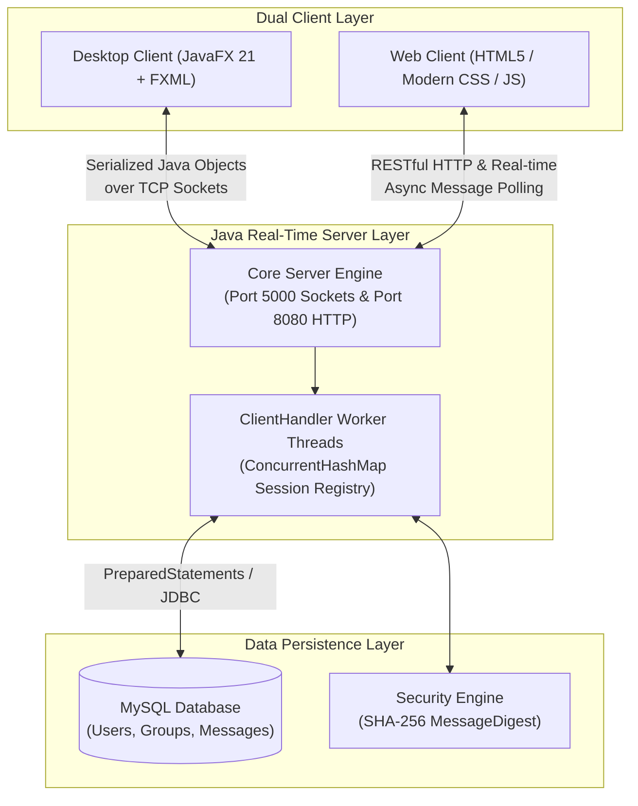
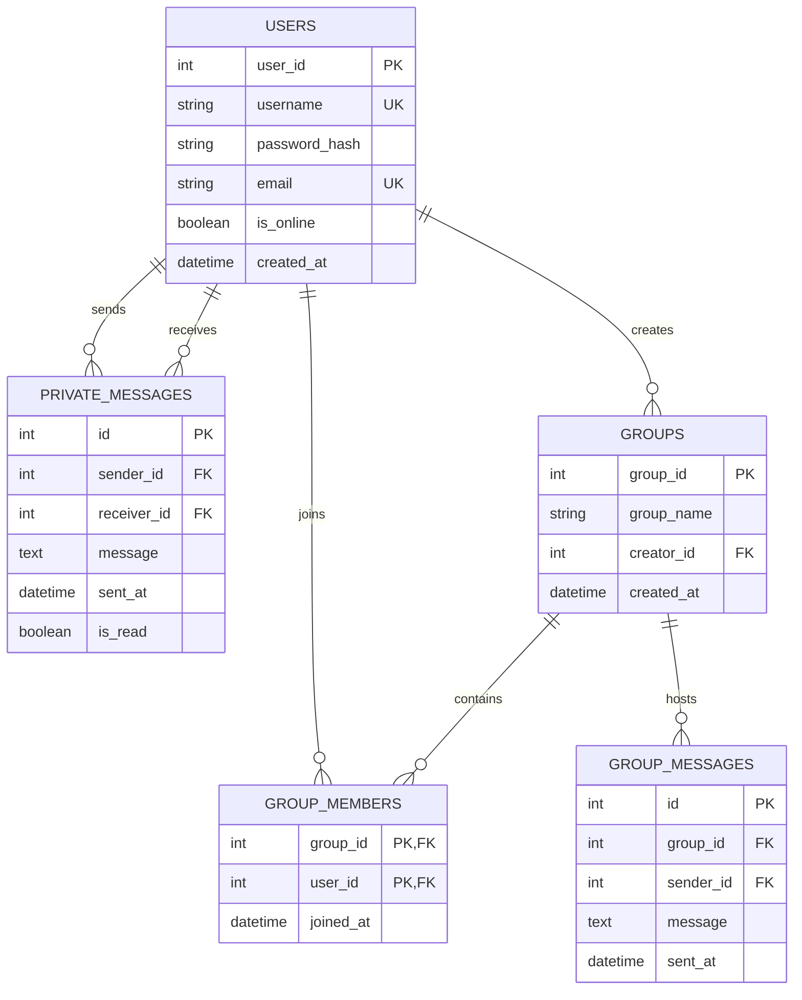

# 💬 Real-Time Chat Application

<p align="center">
  
  
  
  
  
  
</p>

---

## 📌 Executive Summary

A comprehensive, production-grade **Real-Time Chat Application** developed for modern interactive communication. Built utilizing a multi-tier client-server architecture featuring:
- **Low-level TCP Sockets** with Java Object Serialization for high-throughput, low-latency messaging.
- **JavaFX 21** rich desktop graphical interface with modern dark mode styling.
- **Full-featured Web Interface** accessible instantly via Google Chrome & modern web browsers.
- **MySQL Database Persistence** with relational schemas, foreign-key cascade integrity, and SHA-256 cryptographic credential hashing.

---

## 🌟 Key Features

| Feature | Description | Status |
|---|---|:---:|
| 🔐 **User Authentication** | Secure registration and login with SHA-256 cryptographic password hashing | ✅ Complete |
| 💬 **1-on-1 Private Messaging** | Direct, real-time messaging between online users with instant delivery | ✅ Complete |
| 👥 **Group Chat Channels** | Multi-user conversation rooms, channel discovery, and custom group creation | ✅ Complete |
| 📜 **Message History & Audit** | Persistent conversation history saved to database and reloaded on reconnection | ✅ Complete |
| 🟢 **Live Online Presence** | Dynamic online/offline indicator status updates pushed to all active clients | ✅ Complete |
| 🖥️ **Dual Client Support** | Works both as a **JavaFX Desktop Application** and as an **Interactive Web App** | ✅ Complete |
| 🎨 **Modern Dark UI** | Sleek chat bubbles, timestamps, responsive sidebar, and auto-scrolling viewport | ✅ Complete |

---

## 🏗️ Architecture & Message Flow



---

## 📁 Repository Directory Structure

```tree
realtime-chat-application-java/
├── database.sql                  # MySQL database schema, constraints, and seed data
├── pom.xml                       # Maven build specification & dependencies
├── README.md                     # Comprehensive project documentation
│
├── src/main/java/com/chatapp/
│   ├── common/
│   │   └── Message.java          # Serializable message protocol (Payloads, Enum types)
│   ├── server/
│   │   ├── ChatServer.java       # Multi-threaded TCP Socket Server (Port 5000)
│   │   ├── ClientHandler.java    # Per-client worker thread for dispatching messages
│   │   └── DatabaseManager.java  # JDBC Singleton handling SQL transactions
│   └── client/
│       ├── Main.java             # JavaFX Application bootstrap
│       ├── ChatClient.java       # Socket client network receiver thread
│       └── controller/
│           ├── LoginController.java  # Authentication GUI logic & validation
│           └── ChatController.java   # Main messenger view controller & state manager
│
├── src/main/resources/com/chatapp/client/
│   ├── view/
│   │   ├── login.fxml            # FXML layout for Authentication
│   │   └── chat.fxml             # FXML layout for Chat Dashboard & Messaging
│   └── css/
│       └── style.css             # JavaFX dark-mode stylesheet
│
└── web-version/                  # Zero-dependency Web-enabled edition
    ├── WebChatServer.java        # Built-in Java HTTP server (Port 8080)
    └── public/
        ├── index.html            # Web messenger layout
        ├── style.css             # Discord/WhatsApp-inspired responsive dark UI
        └── app.js                # Real-time event polling and message rendering
```

---

## 🗄️ Database Schema & Relational Design

The system implements strict relational normalization with relational integrity constraints:



---

## 🚀 Getting Started

### 1. Database Initialization
Execute the included schema script in MySQL Workbench or via terminal:
```bash
mysql -u root -p < database.sql
```

> **Pre-configured Seed Credentials for Quick Testing:**
> * Username: `alice` | Password: `password123`
> * Username: `bob`   | Password: `password123`

---

### 2. Running the Web Version (Instant in Chrome)
A self-contained Java HTTP server that opens directly in Google Chrome:
```bash
cd web-version
javac WebChatServer.java
java WebChatServer
```
Open **Google Chrome** at [http://localhost:8080](http://localhost:8080).

---

### 3. Running the Desktop Application (JavaFX)
Ensure Java 17+ and Maven are installed:
```bash
# Terminal 1: Start Server
mvn exec:java -Dexec.mainClass="com.chatapp.server.ChatServer"

# Terminal 2: Launch Client GUI
mvn javafx:run
```

---

## 🔒 Security Best Practices Implemented

* **Password Security**: Credentials are protected using one-way cryptographic SHA-256 hashing. Passwords are never stored or transmitted in plain-text.
* **SQL Injection Prevention**: All queries and database interactions strictly utilize parameterized `PreparedStatement` interfaces.
* **Concurrency Control**: Server uses `ConcurrentHashMap` for synchronized tracking of active user sessions across concurrent worker threads.

---

## 👨‍💻 Author

**Indrasena Reddy Mittapalli**  
* GitHub: [@mittapalliindrasenareddy913-web](https://github.com/mittapalliindrasenareddy913-web)  
* Project: **Internship Task 5 — Real-Time Chat Application**  
* Organization: **CODEC TECHNOLOGY**
